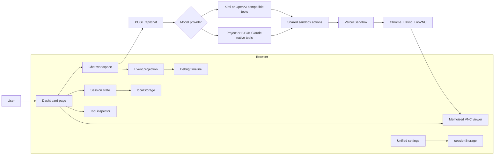
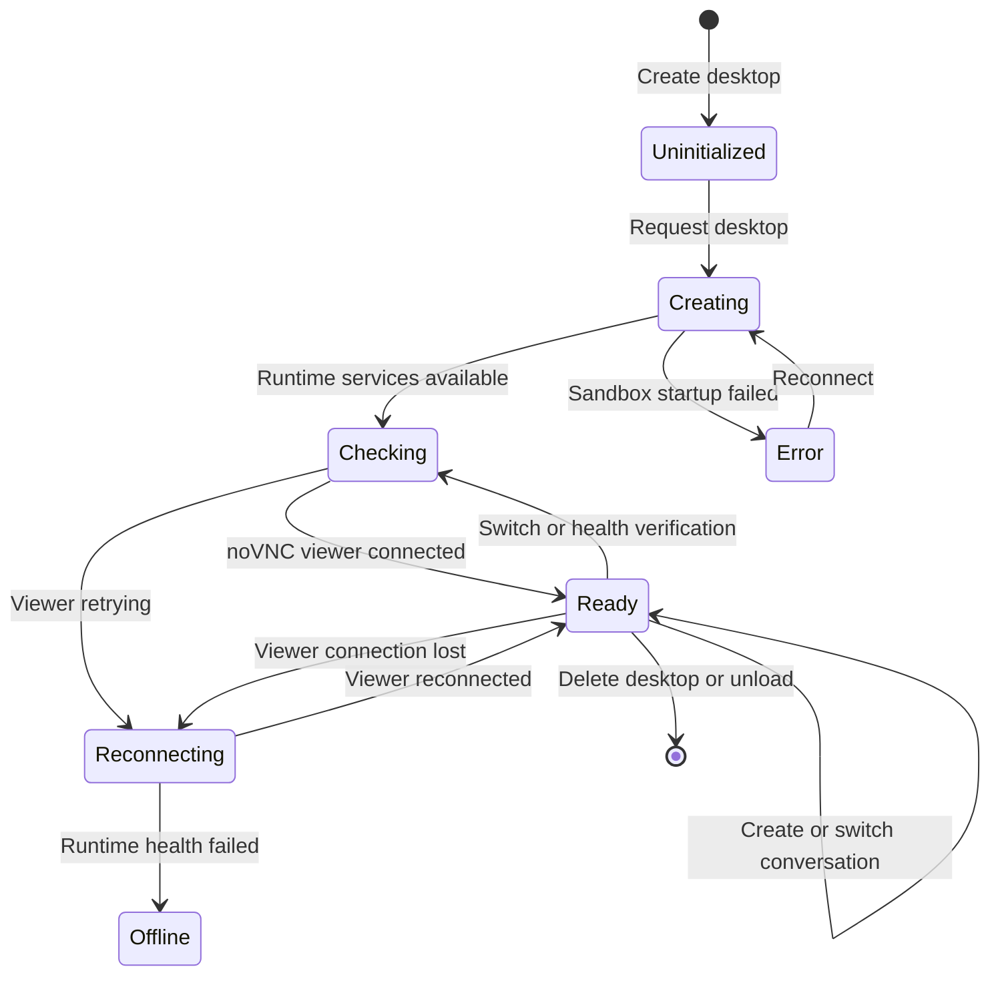
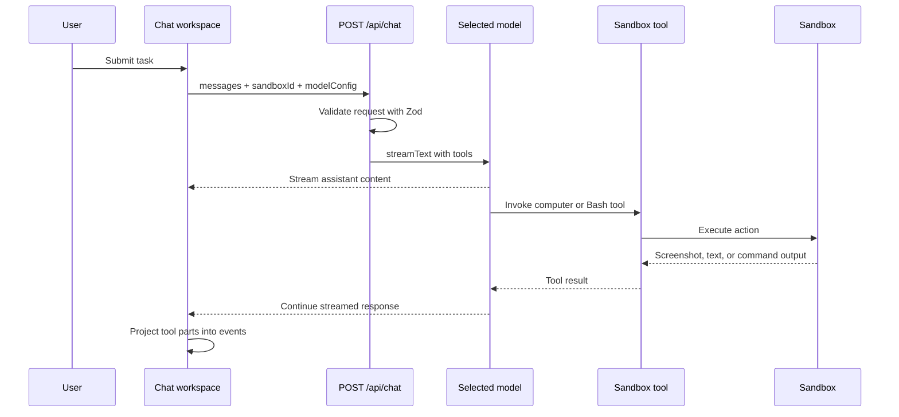

<!--
File: repowiki.md
Purpose: Document the repository architecture, runtime flows, module boundaries, and extension points in detail.
Problem solved: Gives reviewers and contributors a code-oriented reference for understanding, evaluating, and extending the system.
-->

# AI Agent Dashboard Repository Wiki

This document describes the architecture implemented in this repository. It is
intended for reviewers, maintainers, and engineers adding models, tools, event
types, or desktop runtimes.

## 1. System Purpose

AI Agent Dashboard is a browser-based control and observability surface for an
AI agent operating an isolated Linux desktop. A user can issue a natural-language
task, watch the agent interact with Chrome through VNC, inspect every computer or
Bash tool call, and keep multiple task histories on the same device.

The repository extends the Vercel Labs AI SDK Computer Use starter with:

- A horizontally resizable chat and desktop workspace.
- Typed, inspectable computer and Bash events.
- Inline tool-call summaries and an expanded inspector.
- A collapsible event timeline and derived activity counters.
- Browser-local desktop sessions with multiple conversations per desktop.
- Memoized VNC rendering isolated from streaming chat updates.
- Local Project Claude plus hosted BYOK for Anthropic, Kimi, and custom OpenAI-compatible models.
- Live, observable activity feedback while the agent is working.
- Persistent FIFO follow-up queues scoped to individual conversations.
- A persistent five-theme interface built on shared semantic design tokens.

## 2. Current Runtime Status

The active desktop runtime is **Vercel Sandbox**, inherited from the upstream
starter. The assignment appendix mentions E2B, but an E2B adapter is not yet
implemented. The migration decision and intended boundary are recorded in
[`docs/adr/001-desktop-runtime-strategy.md`](docs/adr/001-desktop-runtime-strategy.md).

Current implementation constraints:

- Tool events are projected from AI SDK message parts on the client.
- Tool duration is client-observed elapsed time, not server-instrumented time.
- Computer targets are coordinate-based and do not include semantic DOM targets.
- Sandbox lifecycle actions are not yet represented in the central event list.
- The UI prevents conflicting session actions while an agent run is active.

These constraints are documented because they define the next architecture
milestones and should not be mistaken for completed functionality.

## 3. Technology Stack

| Layer | Technology | Responsibility |
|---|---|---|
| Web framework | Next.js 15 App Router | Pages, route handlers, server actions, build pipeline |
| UI runtime | React 19 | Stateful dashboard composition and streaming updates |
| Styling | Tailwind CSS 4 + shadcn/ui primitives | Responsive layout and reusable controls |
| Streaming AI | Vercel AI SDK 4 | Messages, streaming responses, multi-step tool calls |
| Local project model | Anthropic Claude | Native computer-use and Bash tool invocation during local development |
| BYOK models | Anthropic, Kimi, and OpenAI-compatible providers | Tab-scoped credentials and provider-appropriate tools |
| Validation | Zod | API payload, persisted configuration, and tool input validation |
| Desktop runtime | Vercel Sandbox | Ephemeral Linux compute and exposed noVNC port |
| Desktop stack | Xvnc, openbox, noVNC, websockify | Virtual display, window management, and browser streaming |
| Automation | xdotool + ImageMagick | Pointer, keyboard, scrolling, and screenshots |
| Persistence | `localStorage` + `sessionStorage` | Sessions and tab-scoped BYOK configuration |

## 4. High-Level Architecture



The browser owns presentation state, desktop-session metadata, and conversation
history. The server owns model
local-development credentials from environment variables, enforces hosted
BYOK, validates provider requests, and executes
sandbox operations. The remote desktop is a separate runtime connected to the UI
through a noVNC iframe.

## 5. Repository Map

```text
app/
  api/chat/route.ts              Streaming model and tool orchestration
  api/kill-desktop/route.ts      Sandbox cleanup endpoint
  globals.css                    Design tokens and global animation styles
  layout.tsx                     Root metadata, fonts, analytics, and toasts
  page.tsx                       Thin dashboard controller and composition root

components/
  dashboard/
    agent-activity.tsx           Live observable agent feedback
    chat-workspace.tsx           AI SDK chat lifecycle and event synchronization
    conversation-switcher.tsx    Accessible custom conversation listbox
    dashboard-shell.tsx          Responsive presentation-only composition
    desktop-session-item.tsx     Desktop row and action menu
    desktop-dialogs.tsx          Create, rename, and delete confirmation dialogs
    debug-panel.tsx              Collapsible event store and counters
    mobile-desktop-switcher.tsx  Mobile desktop navigation and status controls
    prompt-queue.tsx             Queued follow-up list and removal controls
    session-sidebar.tsx          Compact session navigation and contextual actions
    tool-inspector.tsx           Expanded event details
    vnc-viewer.tsx               Memoized noVNC iframe
  ui/                            Shared shadcn-style primitives
  input.tsx                      Chat composer
  message.tsx                    Messages and inline tool cards
  model-settings.tsx             Auto-saving API and theme settings panel
  project-info.tsx               Empty-state capability summary
  prompt-suggestions.tsx         Example agent tasks
  theme-provider.tsx             Theme persistence and document integration
  theme-switcher.tsx             Custom dark-theme dropdown and live preview

lib/
  ai/
    anthropic.ts                 Anthropic provider configuration
    browser-routing.ts           Visible-browser intent detection
    kimi.ts                      OpenAI-compatible model and image middleware
    model-config.ts              Model configuration types and validation helpers
  dashboard/
    events.ts                    Tool/runtime event normalization and derived state
    presentation.ts              Stable labels and presentation keys
    session-storage.ts           Versioned browser persistence and redaction
    types.ts                     Event and session contracts
    use-dashboard-persistence.ts Session hydration and persistence
    use-dashboard-tutorial.ts    First-open tutorial state
    use-desktop-layout.ts        Responsive breakpoint projection
    use-desktop-runtime.ts       Sandbox/noVNC lifecycle orchestration
  sandbox/
    actions.ts                   Shared computer and Bash execution
    config.ts                    Desktop resolution
    create-snapshot.ts           Reusable sandbox image creation
    generic-tool.ts              Provider-neutral AI SDK tools
    tool.ts                      Anthropic-native tool bindings
    utils.ts                     Sandbox and noVNC lifecycle

docs/adr/                        Architecture decision records
```

## 6. Browser Composition and State Ownership

`app/page.tsx` is the composition root. Purpose-specific hooks own persistence
and runtime orchestration, while the page coordinates cross-region selections:

| State | Owner | Consumers |
|---|---|---|
| Desktop sessions and active session | Persistence hook | Sidebar, chat, VNC, inspector |
| Conversations and active conversation | Individual desktop session | Chat, debug panel, inspector, persistence |
| Sandbox stream URLs | Desktop runtime hook | VNC viewer |
| Selected event ID | Dashboard page | Inline cards and tool inspector |
| Current agent status | Dashboard page | Header metrics and interaction guards |
| Model configuration | Persistence hook | Model settings and chat request body |
| Sandbox/noVNC lifecycle events | Individual desktop session | Debug panel, inspector, persistence |
| Messages and projected events | Individual conversation | Chat, debug panel, inspector, persistence |
| Queued prompts | Individual conversation | Queue list, composer, FIFO dispatcher, persistence |
| Chat input and stream status | Chat workspace | Composer and activity feedback |
| Interface theme | Theme provider | Document tokens, unified settings panel, browser persistence |

The page creates stable callbacks for desktop refresh and conversation updates.
This allows child components to remain focused on one responsibility and prevents
the VNC subtree from receiving token-level message state.

### Theme system

`theme-provider.tsx` uses a named `data-theme` attribute and local browser
storage to keep the selected interface across visits. `app/globals.css` maps
semantic surface, neutral, brand, border, and radius tokens to dark Vercel, Vue,
Xcode, and GitHub palettes. Every palette declares a dark browser color
scheme and preserves neutral dark canvas and surface levels; theme identity
comes primarily from accent, primary, text, contrast, and radius tokens rather
than a tinted background or light-mode variant. Components consume those shared tokens, so streaming, session,
inspector, toast, and modal surfaces switch together without remounting the
dashboard.

`theme-switcher.tsx` renders an accessible custom listbox and a miniature live
dashboard preview inside the unified settings dialog. Theme selection applies
immediately and persists as a device-local preference containing no credentials
or conversation data. On wide screens the Settings body places API configuration
on the left and Appearance on the right; smaller screens collapse to one
scrollable column.

`model-settings.tsx` owns the bottom-left Settings trigger and the unified
dialog. Local development can select Project Claude; hosted builds show one
BYOK provider dropdown for Anthropic, Kimi, or OpenAI-compatible endpoints.
Valid BYOK drafts are applied automatically after a short input debounce, while
provider and theme choices require no save button. Invalid or incomplete BYOK
drafts remain local to the dialog and do not replace the last valid model
configuration. API fields are locked during an active agent run, but theme
selection remains available.

### Responsive composition

- **Desktop and tablet:** a horizontal `ResizablePanelGroup` divides chat and
  desktop surfaces. The session rail collapses at narrower tablet widths.
- **Phone:** a fixed vertical split keeps the live VNC desktop in the upper 46%
  and the conversation workspace in the lower 54%. Desktop switching, readiness,
  reconnect, and creation controls sit above the VNC surface. The inspector is
  omitted from the primary phone layout so chat input remains continuously
  available.
- **VNC:** the same viewer instance contract is used in both layouts.

### VNC display modes

`vnc-viewer.tsx` supports `embedded`, `minimized`, and `pip` display modes. The
dashboard owns the active mode so the surrounding desktop and phone layouts can
release space when the viewer leaves its embedded position. The viewer keeps one
keyed iframe mounted across mode changes, preserving the noVNC connection instead
of allocating a new sandbox or desktop stream.

Picture-in-picture uses a fixed, viewport-constrained window whose header is a
mouse and touch drag handle. Its position is clamped again after viewport resize.
On desktop, minimizing produces a compact restore dock and lets the inspector fill
the right panel. On phone, the existing top desktop bar provides restore and PiP
controls while the conversation workspace expands into the released space.

## 7. Desktop Sessions and Conversations

Each `ChatSession` owns:

- A unique desktop-session ID, title, persisted pin state, and timestamps.
- Sandbox ID and runtime generation.
- Connection status.
- Active conversation ID.
- One or more `ChatConversation` records.

Each `ChatConversation` owns its own title, timestamps, AI SDK messages,
normalized agent events, queued prompts, and revision counter. Conversations
inside the same session intentionally share the session's sandbox and VNC
stream.



### Creation

`createEmptySession()` creates a desktop session with its first empty
conversation without immediately assigning a sandbox. Once the session becomes
active, the dashboard calls `getDesktopURL()`.
The returned sandbox ID and noVNC URL are stored separately: session metadata is
persistable, while the live stream URL remains in memory.

### Conversation creation and switching

`createEmptyConversation()` adds a new independent message and event history to
the active desktop session. It does not modify the sandbox ID, stream URL, or VNC
generation, so the remote desktop keeps its current browser and filesystem state.

The chat workspace treats the New action as idempotent while the current
conversation has no messages, normalized events, or queued prompts. In that
state it focuses the existing composer and does not call the session creation
callback. Once any of those content sources exists, the same action creates and
selects a new conversation normally.

`conversation-switcher.tsx` renders the conversation picker as a custom listbox
instead of a native select. It keeps titles and message or queue metadata visible,
marks the active conversation, closes on outside click or Escape, and supports
arrow-key navigation. Switching is disabled while the current agent run is active
so the stream cannot be detached from its owning conversation.

Switching conversations remounts only the chat workspace and restores that
conversation's inspector selection. The VNC viewer continues receiving the same
stable desktop props.

### Desktop creation, pinning, renaming, ordering, and deletion

Creating a desktop opens a naming dialog before any session or sandbox work
starts. The field defaults to `Desktop 123`, enforces a 40-character limit, and
rejects case-insensitive duplicate names. Confirming creation appends and selects
the new session; the existing readiness pipeline then allocates its runtime.

The desktop rail starts in a compact icon-first layout and can be resized between
84 and 240 pixels from its right edge. Its width is persisted in browser storage.
At wider sizes, rows reveal their desktop names between the square desktop icon
and the three-dot action trigger. Hovering or focusing the desktop icon opens a
portal-rendered detail card with the desktop name, live connection state,
conversation count, and pin state. The three-dot menu provides pin or unpin,
edit, and delete actions without changing the rail width. Pin state is stored on
`ChatSession`; pinning moves the desktop into the leading pinned group while
preserving the relative order of the other sessions. Pinned rows receive a
distinct brand-tinted background, and the final pinned row renders a subtle group
divider. Renaming uses the same validation rules as creation and does not alter
the active runtime.

Desktop items use native drag data for ordering while the sidebar renders an
explicit before or after insertion marker. `Alt + ArrowUp` and `Alt + ArrowDown`
provide a keyboard equivalent. Dragging across the pinned boundary adopts the
target group's pin state. Reordering never changes active selection or sandbox
identity, and the established browser persistence path records the new order.

Desktop dragging is limited to reordering; dropping a desktop never deletes it.
Deletion is available only from the row's three-dot menu and always opens the
destructive confirmation dialog. Runtime termination and local history removal
happen only after confirmation. The final desktop can also be deleted, which
leaves a persistent empty state with direct Create desktop and Settings access.

### Desktop switching

Switching desktop sessions selects a different sandbox and its active
conversation. If the sandbox ID still points to a running runtime, the server
reconnects to it. Otherwise, a replacement sandbox is created and the generation
counter changes so the iframe can be intentionally remounted.

### Deletion and unload

Deleting a desktop session calls `/api/kill-desktop` before removing its
conversations and local state. The
page also sends cleanup beacons for known sandboxes during `pagehide`.

### Concurrency policy

The current UI blocks session mutations while the active agent is not idle, but
the composer always remains available. A prompt runs immediately only when the
desktop is ready, the agent is idle, and the conversation queue is empty.
Otherwise it enters that conversation's persistent FIFO queue. The user can
remove queued items; the dispatcher submits exactly one item when the desktop
becomes ready or the previous run finishes. This prevents overlapping commands
against one desktop without blocking follow-up planning.

## 8. Chat and Streaming Flow



`components/dashboard/chat-workspace.tsx` wraps `useChat`. Its request body
contains the active sandbox ID and selected model configuration. `maxSteps: 30`
allows the model to alternate between reasoning output and tools until the task
finishes or reaches the step limit.

The activity component reports observable phases:

- Desktop initialization.
- Request submission and plan generation.
- Active computer or Bash operation.
- Transition from a completed tool to the next model step.

It does not claim to expose hidden chain-of-thought.

## 9. Model Routing and BYOK

The model configuration is a discriminated union with four variants:

```ts
type ClientModelConfig =
  | { provider: "anthropic" }
  | {
      provider: "anthropic-byok";
      apiKey: string;
      modelId: string;
    }
  | {
      provider: "kimi";
      apiKey: string;
      modelId: string;
      reasoningEffort: "low" | "high" | "max";
    }
  | {
      provider: "custom";
      apiKey: string;
      baseUrl: string;
      modelId: string;
    };
```

### Project Claude path

- Uses server environment variables only during local development.
- Is rejected by the API in production and other hosted builds even if a
  shared key is present.
- Uses Anthropic's native computer-use and Bash tool definitions.
- Can use an Anthropic-compatible gateway through `ANTHROPIC_BASE_URL` and
  `ANTHROPIC_MODEL`.

### Anthropic BYOK path

- Uses the official Anthropic Messages API with the visitor's tab-scoped key.
- Accepts a configurable Claude model ID.
- Uses the same native computer-use and Bash tool definitions as Project Claude.

### Kimi preset

- Uses the Kimi Code OpenAI-compatible endpoint `https://api.kimi.com/coding/v1`.
- Defaults to model ID `k3`, which remains editable in the UI.
- Accepts a Kimi Code membership API key stored only in the current browser tab.
- Uses generic AI SDK function tools instead of Anthropic-native schemas.
- Applies the selected reasoning effort through OpenAI provider options.
- Sends `temperature: 1`, which is required by the K3 API.

### Custom path

- Accepts a public HTTPS OpenAI-compatible Base URL.
- Requires an API key and model ID.
- Rejects localhost, private IPv4 ranges, and literal IPv6 hosts before the
  request reaches the provider factory.
- Uses the same generic computer and Bash tools as Kimi.

### Screenshot middleware

Generic tool results can contain an image payload. `lib/ai/kimi.ts` rewrites a
screenshot result into a following multimodal user message so an
OpenAI-compatible vision model can inspect the current desktop. Providers used
through the custom path must support tool calls and image input for full
computer-use behavior.

## 10. Tool Execution Layer

The tool layer separates provider schemas from sandbox execution:

```text
Anthropic native definitions ─┐
                              ├─> shared actions ─> Vercel Sandbox
Generic AI SDK definitions ───┘
```

### Computer actions

`lib/sandbox/actions.ts` validates and handles actions including:

- Screenshot.
- Click, double-click, right-click, and mouse movement.
- Text entry and keyboard keys.
- Scrolling and drag operations.
- Wait and pointer inspection operations.

Actions execute with `xdotool` against display `:99`. Screenshots use
ImageMagick and return base64-encoded PNG data.

Coordinates use a fixed-length numeric array schema rather than a JSON Schema
tuple. This preserves the `[x, y]` contract while remaining compatible with
Kimi Code's Moonshot-flavored function schema validator.

### Visible-first browser policy

Website navigation, search, page reading, forms, and other visual interface work
must use the computer tool against the visible Chrome window. The model is told
to capture the screen before its first action and after navigation or major
visual changes. It must not replace observable browser work with `curl`, `wget`,
headless automation, or Bash-based web requests.

This policy has two enforcement layers. `lib/ai/browser-routing.ts` recognizes
web, weather, forecast, search, latest-information, and equivalent Chinese
intents when the newest message is from the user. `/api/chat` then forces the
first model step to call `computer`; later tool-result turns return to automatic
tool selection. The system instruction separately requires screenshots and
visible Chrome navigation. This makes the canonical "What's the weather in
Dubai?" demo observable without forcing every later step into another tool call.

### Bash actions

Bash commands execute inside the same sandbox as the desktop. This allows an
agent to inspect files, create artifacts, and use shell tools without losing the
visual session context. Bash is reserved for non-visual work and is labeled as a
`Background command`; computer events are labeled as a
`Visible desktop action` throughout the chat timeline and inspector.

## 11. Desktop Runtime and VNC

`lib/sandbox/utils.ts` owns the current runtime lifecycle:

1. Reconnect to a supplied running sandbox ID when possible.
2. Otherwise create a sandbox from `SANDBOX_SNAPSHOT_ID`.
3. Install a small noVNC status bridge and start the desktop environment script.
4. Verify both the Xvnc backend on port `5900` and noVNC HTTP service on port `6080`.
5. Set the X11 background and launch Chrome.
6. Return an autoconnecting noVNC URL and wait for the viewer handshake.
7. Recheck known runtimes every ten seconds and whenever the page becomes visible or focused.

Runtime availability and viewer connectivity are deliberately separate. The UI
displays `checking`, `reconnecting`, or `offline` until all required checks pass.
Connection status is excluded from `localStorage`, so a previously ready desktop
cannot reappear as ready after reload without a new health check and viewer
handshake.

The snapshot created by `lib/sandbox/create-snapshot.ts` preinstalls the desktop
stack so individual sessions do not repeat expensive package installation.

### Render isolation

`VncViewer` is wrapped in `React.memo` with an explicit comparison over:

- Stream URL.
- Sandbox ID.
- Runtime generation.
- Connection status.
- Agent status and the current tool event.
- Stable refresh callback.

The activity props update a parent overlay without changing the iframe key or
source. While the agent is busy, this overlay shows planning state, the current
action, command text or pointer target, and whether the action is visible or
background. This makes background work observable without opening a terminal
window that could steal focus from browser automation.

It receives no messages or event arrays. A streaming token update therefore
changes the chat subtree without changing the VNC component's props. The VNC
surface also uses paint containment so remote-frame repaints do not invalidate
the surrounding dashboard.

### Interaction performance

The live chat remains the highest-frequency surface, so it uses several explicit
rendering boundaries:

- Conversation projection into the parent session store is capped at ten updates per second while streaming and flushed immediately when a run finishes.
- Session persistence waits for a quiet period and executes during browser idle time, with a synchronous page-exit flush for safety.
- Tool event arrays preserve their identity when only assistant text changes.
- Completed messages, the desktop rail, switchers, activity feedback, and the inspector use memoized boundaries.
- Streaming assistant text renders as lightweight plain text and receives full Markdown formatting when the response completes.
- Chat auto-scroll and draggable surfaces coalesce pointer or mutation bursts into one update per animation frame.
- Off-screen messages use content visibility, while screenshots decode asynchronously and chat thumbnails load lazily.

## 12. Event Pipeline

AI SDK tool invocation parts are normalized into a discriminated union:

```ts
type ToolEvent = ComputerEvent | BashEvent;
type AgentEvent = ToolEvent | RuntimeEvent;
```

Common fields include:

- `id`
- `sessionId`
- `toolCallId`
- `timestamp`
- `durationMs`
- `status`

The `kind` discriminator separates `computer`, `bash`, and `runtime` payloads. Computer
events store the normalized action, coordinates, optional text, scroll data,
target metadata, and screenshot or text results. Bash events store the command
and output. Runtime events record Sandbox create/reconnect/health/destroy and
noVNC connect/disconnect lifecycles at the Desktop session level.

### Projection

`syncAgentEvents()` scans message parts, indexes existing events by tool-call ID,
and updates each event as the AI SDK invocation changes from a request to a
result. Runtime helpers record pending and terminal states with the same event
envelope. Tool and runtime streams are merged chronologically for presentation.

### Derived state

The event module derives:

- Counts per action type.
- Human-readable event labels.
- Agent state: `idle`, `thinking`, or `executing`.

Derived data powers the global header, inline cards, live activity feedback,
debug panel, and expanded tool inspector.

### Current event limitations

- `pending` currently covers the observable pre-result phase; initiated and
  executing are not represented separately.
- `durationMs` measures time between client observations.
- Sandbox create, reconnect, and stop operations are not event variants yet.
- Browser targets report coordinates rather than semantic elements.

## 13. Persistence and Data Safety

### Session history

Sessions use versioned `localStorage` keys. Restored data is validated with Zod,
message dates are revived, and connection status resets to `uninitialized` so
the application verifies the runtime again.

Screenshot payloads are intentionally replaced with a text marker before
storage. This avoids exceeding browser storage quotas with base64 image data.

### BYOK credentials

- Keys are stored in `sessionStorage`, not `localStorage`.
- Closing the tab clears browser-held model configuration.
- Keys are sent to this application's `/api/chat` route for forwarding.
- Keys are never copied into session history or rendered in the event inspector.
- Users should only enter a key on a deployment whose operator they trust.

### Custom endpoint validation

The client and server both use the same Base URL validation helper. It requires
HTTPS and blocks obvious loopback and private network destinations. This reduces
server-side request-forgery exposure, though production deployments should also
enforce outbound network policy and DNS-level protections.

## 14. UI Responsibility Map

| Surface | Source | Responsibility |
|---|---|---|
| Global header | `app/page.tsx` | Product identity and agent status |
| Desktop history | `session-sidebar.tsx` | Desktop navigation, cleanup, and bottom-left settings entry |
| Chat stream | `chat-workspace.tsx` | Conversation selection, creation, message lifecycle, and submission |
| Prompt queue | `prompt-queue.tsx` | FIFO position, readiness guidance, and queued-item removal |
| Message row | `message.tsx` | Copyable text with feedback and inline tool visualization |
| Activity feedback | `agent-activity.tsx` | Current observable operation and elapsed time |
| Debug panel | `debug-panel.tsx` | Event store timeline and action counts |
| Remote desktop | `vnc-viewer.tsx` | noVNC connection and reconnect status |
| Tool inspector | `tool-inspector.tsx` | Full screenshot, command output, action details, JSON copy |
| Unified settings | `model-settings.tsx` | Local Project Claude, hosted BYOK dropdown, VNC diagnostics, data, tutorial, and themes |

## 15. API Surface

### `POST /api/chat`

Request fields:

| Field | Description |
|---|---|
| `messages` | AI SDK UI message history |
| `sandboxId` | Active remote desktop identifier |
| `desktopReady` | Literal readiness assertion from the connected dashboard viewer |
| `modelConfig` | Discriminated project Claude, Anthropic BYOK, Kimi, or custom configuration |

The route validates the body and rechecks Sandbox, Xvnc, and noVNC health before
creating the model or allowing a tool call. An unavailable desktop returns HTTP
409 and remains owned by the session queue. Invalid configuration returns HTTP
400, while hosted Project Claude requests return HTTP 403. Unexpected model
failures return HTTP 500 without destroying the desktop.

### `/api/kill-desktop`

Accepts a sandbox ID and stops the corresponding runtime. Both GET and POST are
supported because page-unload cleanup and explicit session deletion have
different browser constraints.

## 16. Error Handling and Robustness

- Zod rejects malformed chat and model configuration.
- Stream errors are serialized into readable messages rather than leaking raw
  provider objects.
- The UI presents provider-aware retry guidance.
- Desktop creation failures update connection status and expose reconnect.
- Existing Sandbox lookups retry short-lived Vercel control-plane network failures before surfacing an error.
- The activity panel derives startup failure feedback from the same connection status as the VNC viewer, preventing contradictory Starting and Error states.
- Desktop readiness is checked in the UI, API route, and tool executor; a stale client state cannot run a command against an unavailable runtime.
- Queued prompts are persisted per conversation and dispatched one at a time.
- Session mutations are blocked during active generation to prevent state races.
- Aborted tool calls receive a normalized cancelled result.
- Stored sessions fail closed to an empty list when parsing fails.

## 17. Extension Guides

### Add a new model provider

1. Add a new variant to `ClientModelConfig`.
2. Extend stored configuration parsing and display labels.
3. Add fields and validation to `DashboardSettings`.
4. Extend the `/api/chat` Zod discriminated union.
5. Instantiate the provider and choose native or generic tools.
6. Include model identity in the conversation revision signature.
7. Document credential handling and multimodal requirements.

### Add a new computer action

1. Add the action to `ComputerAction`.
2. Extend the Zod action schema.
3. Implement execution in `executeComputerAction()`.
4. Add normalization in the event projection if the payload is new.
5. Add labels and details to the activity bar and tool inspector.
6. Test pending, success, error, and cancellation behavior.

### Add a new event type

1. Define an interface extending `EventBase` with a unique discriminator.
2. Add it to `AgentEvent`.
3. Create it at the authoritative lifecycle boundary.
4. Update counts, labels, persistence redaction, debug rendering, and inspector
   rendering.
5. Preserve exhaustive TypeScript narrowing and avoid `any`.

### Replace the desktop runtime

The target runtime adapter must provide equivalent operations for:

- Create or reconnect by runtime ID.
- Run attached and detached commands.
- Supply environment variables.
- Expose a public noVNC URL.
- Report runtime status.
- Stop the runtime.

The UI should continue consuming only a sandbox ID, connection status, runtime
generation, and stream URL. See ADR 001 for the migration rationale.

## 18. Quality and Verification

The repository exposes the following checks:

```bash
pnpm lint
pnpm typecheck
pnpm test
pnpm test:e2e
pnpm build
pnpm check
```

`pnpm check` runs linting, TypeScript validation, unit tests, and a production
build. CI runs the same command plus the Chromium browser suite for pushes to
`main` and pull requests.

Current automated coverage includes:

- Event lifecycle and ordering tests.
- Session serialization and runtime-event persistence tests.
- First-open tutorial persistence and Settings replay in Chromium.
- Named Desktop creation at desktop and mobile breakpoints.

Future coverage should add model configuration validation, a VNC render-count
regression, live Claude/Kimi tool-call flows, and Sandbox failure recovery.

## 19. Environment Configuration

| Variable | Purpose |
|---|---|
| `ANTHROPIC_API_KEY` | Local-development Project Claude credential; ignored for hosted model access |
| `ANTHROPIC_BASE_URL` | Optional Anthropic-compatible Messages API prefix |
| `ANTHROPIC_MODEL` | Optional Claude model override |
| `SANDBOX_SNAPSHOT_ID` | Prebuilt desktop image used for new sandboxes |
| `NEXT_PUBLIC_APP_URL` | Canonical URL used by application metadata |
| `VERCEL_OIDC_TOKEN` | Preferred linked-project sandbox authentication |
| `VERCEL_TOKEN` | Alternative manual Vercel authentication |
| `VERCEL_TEAM_ID` | Team scope for manual authentication |
| `VERCEL_PROJECT_ID` | Project scope for manual authentication |

BYOK credentials are intentionally absent from environment setup because they
are entered through the model settings interface and scoped to one browser tab.

## 20. Architectural Principles

The current codebase follows these principles:

1. **Observable behavior over opaque loading:** every known action should be
   visible in chat, the VNC activity overlay, debug state, or the inspector.
2. **Typed boundaries:** model configuration, tool input, events, and persisted
   state are validated or represented with explicit TypeScript types.
3. **Runtime isolation:** each desktop session owns one remote desktop identity; its conversations intentionally reuse it.
4. **Rendering isolation:** chat streaming must not remount the VNC viewer.
5. **Provider separation:** model-specific schemas wrap shared execution logic.
6. **Credential minimization:** project keys remain server-side and BYOK keys
   remain tab-scoped.
7. **Honest documentation:** current limitations and future adapters are stated
   explicitly.

## 21. Related Documentation

- [Project README](README.md)
- [ADR 001: Desktop runtime strategy](docs/adr/001-desktop-runtime-strategy.md)
- [Environment example](.env.example)
